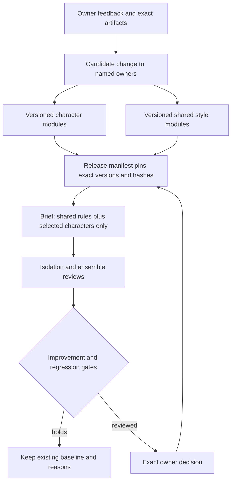

# Creative system

This is the offline standards and continuity layer for Full Time creative work.
It preserves character differences and records what the owner actually approved.
It makes no provider calls and cannot generate, spend or publish.

Start each creative session with:

```bash
python3 growth.py standards startup
```

Then read the private `local/creative-system/START-HERE.md`. Missing private data
is an error: restore the authorised private bundle rather than creating a new
baseline from a chat summary. The public repository contains the schema, engine,
documentation and synthetic tests. Session dialogue, actual grades, production
files and creative assets remain in ignored `local/creative-system/`.

## One owner for each kind of instruction



| Owner | Owns | Does not own |
|---|---|---|
| Product core in `krishanraja/full-time` | Reusable identity, individual delivery and product policy | Ad scripts, sofa cast, scene and publication decisions |
| Each growth character variant | Scoped ad exaggeration, casting references and individual performance | A second reusable product identity or another character's behaviour |
| Shared humour | Joke construction, target clarity and payoff | A uniform delivery for every character |
| Shared story | Scene causality, interrupted sentence handoffs and reactions | Recasting or changing the locked soundtrack |
| Shared visual | Faces, lip sync, blocking, eyelines and restraint | Voice identity or a new script |
| Shared performance | Ensemble register, pace and room coherence | A character's individual accent or worldview |
| Shared brand/format | First-party identity and phone-readable composition | Publication authority or product claims |

Each rule has a stable ID owned by its module, a surface, media applicability,
observable, evidence IDs and an evidence state. Explicit owner requirements are
distinguished from candidate interpretations and missing evidence. There is no
generic adjective score, averaged quality rating or fabricated held-out result.
Each module has a maximum of twelve active rules. Consolidation creates a new
version with provenance; an ever-growing set of overlapping prompts is refused.

Characters can depend on shared modules; they cannot inherit sibling characters.
Composition includes separate sections, not a recursive merge of prompt fields.
Unknown fields, cross-owner rules, duplicate IDs, missing provenance, changed
locks and mismatched hashes fail before composition.

Rules can also declare explicit piece IDs and formats. A locked joke belongs to
its story, and two-panel staging belongs to its format; neither becomes a global
personality requirement. Scoped rules require explicit composition context.
The compiler omits rules outside that context before it assembles instructions.

This layer governs the fictional advertising surface. Product personas stay
owned by the product repository; a scoped advertising performance does not
silently replace a full-show identity. Product-only characters without graded
advertising evidence are registered as awaiting evidence and cannot quietly
receive a copied Romantic, Doomer or Wind-Up performance.

## Product core and the growth bridge

The actual product owns `src/lib/pundit/personality/`: six independent, versioned
profiles plus shared delivery and policy. Its writer, judges and narrator read
the same registry, and stored scripts retain the hashes they used. See the
[product guide](https://github.com/krishanraja/full-time/blob/main/docs/25-personality-system.md).

Export a committed product core with `pnpm run personas:export EXPLICIT_PATH` in
that repository. Then import its exact file hash here:

```bash
python3 growth.py standards import-product EXPORTED_CORE.json --sha256 EXACT_FILE_SHA256
```

Import validates source/profile hashes and stores `product-core/<commit>.json`.
It does not activate anything. A creative release pins that file and each linked
character declares `product_persona_id`. Composition includes the shared reusable
delivery and only the selected identities, followed by their scoped ad variants.
The fixed pundit and sofa mates are ad-only cast. Product factual licensing and
long-show pacing do not become instructions for a fictional ad.

A changed core pin must be declared as `product.core` in `plan-change`; it expands
the review to all linked characters. Growth does not follow a floating `main`.
General identity improvements go back to the smallest owning product profile;
scene-only corrections stay here. New exports still need a new pinned release
and comparison review. This is a versioned learning loop, not automatic prompt
mutation from every comment or an automatic claim of better humour.

## Files and records

`schema.json` is the canonical typed record contract. The stdlib validator
implements only the vocabulary used in that file and refuses unknown schema
keywords; it is not a general JSON Schema library.

Private data has this structure:

```text
local/creative-system/
  CURRENT.json                     # exact current release and canonical digest
  releases/<id>.json               # pinned composition, limits and next action
  modules/<owner>/<semver>.json    # immutable character/shared versions
  evidence/<version>.json          # scoped quotes and artifact judgments
  cases/<version>.json             # frozen canaries and ensemble cases
  feedback/<event-id>.json         # append-only corrections, not auto rules
  productions/<id>.json            # exact assets, cast and technical status
  reviews/<id>.json                # judgments bound to exact inputs
  promotions/<decision-id>.json    # prior pointer, reviews and owner decision
  product-core/<commit>.json       # verified immutable product export
  archive-manifest.json            # original-file inventory and hashes
  archive/                        # original media and production sources
  intake/                         # authority, source boundary and honest gaps
  START-HERE.md                    # next session's human-readable entrypoint
```

An audio approval, a storyboard approval and a video approval are different
records. Approval of one dimension does not approve the complete asset. A later
rejection stays active without erasing historical approvals. Historical receipts
are retained as evidence of what was checked at the time, not current verdicts.

## Working cycle

1. Load `startup`, read the current private handoff and inspect exact references.
2. Record the owner's correction with `feedback`. This creates an immutable,
   idempotent event; it does not edit the active standard.
3. Name the lowest owner that needs changing. A voice texture correction belongs
   to that character; sentence logic belongs to story; exaggerated mutual smiling
   belongs to visual staging. Keep ambiguous or contradictory scope explicit.
4. Create new module versions and a candidate release. Leave existing versions
   and approved asset locks intact. Do not append another competing prompt file.
5. Run `plan-change`. Undeclared changes fail. Character isolation canaries run
   for every candidate; a shared edit affects all dependent characters and the
   relevant ensemble cases. Existing cases cannot be removed to rescue a change.
6. Prepare short, controlled comparisons on the same football material. Hold
   script, other cast, source audio and framing fixed where the change permits.
   Reuse byte-identical approved references for unaffected characters; do not
   regenerate them just to fill a test matrix. New generation needs separate
   exact authority and cost preparation.
7. Record criterion-level judgments tied to release, case and artifact hashes.
   An agent can prepare the complete review table and an advisory assessment.
   The owner can judge the exact comparison pack in one review; this is not a
   requirement to conduct a new interview or ask one question per table row.
   Carry-forward owner judgments cite the original approval and identical bytes;
   an agent cannot invent an owner verdict. Unknown and not-applicable findings
   do not become passes. A technical/model review cannot certify comedy.
8. Run `change-gate`. A failure retains the old baseline. No scalar humour gain
   can cancel a personality, naturalism or clarity regression. At least one
   affected comparison needs an owner-observed improvement; all ties do not
   justify replacing the baseline. Preserve the owner's reason alongside the
   candidate/baseline/tie preference.
9. `promote` requires an exact owner decision bound to the candidate and review
   set. It journals the prior pointer for recovery and changes only the standards
   pointer under a single-writer lease. An identical completed decision replays
   idempotently. A leftover crash lease needs deliberate recovery after checking
   the journal and pointer. Promotion grants no generation or publishing authority.
10. Update the private next action, export a verified bundle and close out NOW.

Keep process learning separate from a standing standard. These records do not
constitute a psychological profile or a calibrated personal-taste model. The
bootstrap uses explicit project instructions and owner-graded artifacts; where
no untouched holdout exists, its measured creative baseline remains null.

Reviewer identity fields are provenance assertions, not an authentication system.
Record an owner verdict only from an actual owner message or trusted approval
record. Agents cannot supply their own owner approvals. The local engine binds
those records to exact inputs; it does not independently authenticate a human
who has edited JSON or certify subjective humour by itself.

## Commands

```bash
python3 growth.py standards startup
python3 growth.py standards compose --piece example --format two_pundit_remote --characters character.romantic character.doomer --output local/creative-system/packets/example.json
python3 growth.py standards feedback local/creative-system/incoming/correction.json
python3 growth.py standards plan-change releases/candidate.json --owners character.doomer
python3 growth.py standards change-gate releases/candidate.json --owners character.doomer --reviews local/creative-system/reviews/comparisons.json
python3 growth.py standards artifact-gate local/creative-system/productions/example.json --reviews local/creative-system/reviews/example.json
python3 growth.py standards promote releases/candidate.json --owners character.doomer --reviews local/creative-system/reviews/comparisons.json --decision local/creative-system/decisions/owner.json
python3 growth.py standards export local/handoff/creative-private.zip
python3 growth.py standards restore local/handoff/creative-private.zip local/creative-system-restored --sha256 EXACT_BUNDLE_SHA256
```

Only `startup` is immediately runnable on a populated workspace. Other paths
above illustrate records that the current task may not yet have created. CLI
exit 0 means the requested operation completed, 1 means invalid input or damaged
state, and 2 means a valid review is held. A held creative is an expected result.

`compose` writes a new packet and refuses overwrite. `export` writes a new private
ZIP outside its source root and a separate hash receipt. Restore checks the
provided ZIP digest, every entry, duplicate entries, path traversal, symlinks and
the complete staged baseline before moving it into a new destination. The ZIP
can contain unpublished creative and owner feedback: never attach it to a public
PR, publish it as an Actions artifact or upload it without separate authority.

New-process startup and a local restore can be tested automatically. They do not
prove that a future model read the entrypoint, that another machine has the
bundle or that an improvement is funny. Keep those evidence limits explicit.

## Existing engine boundaries

The public acquisition pipeline still uses published audio, exact quotations,
verified facts and the existing release, rail, channel and consent gates.
Fictional ad scripts are development artifacts, not evidence that the product
already performs that scene. An internal captured baseline is not a live
growth campaign, product deployment, ads budget or go-live decision.

Run the full repository checks plus the synthetic creative-system tests:

```bash
python3 growth.py --self-test
python3 -m unittest discover -s tests -v
python3 scripts/verify_repository.py
```
